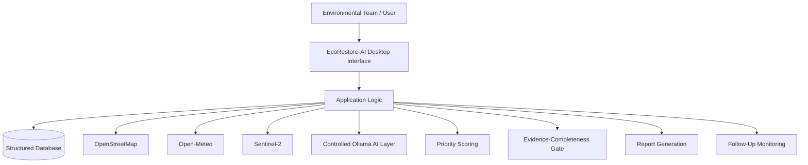

<div align="center">

# EcoRestore-AI

### Evidence-Aware Decision Support and Process Automation for Urban Lake Restoration Prioritization and Monitoring

<p>
  
  
  
  
  
  
</p>

**EcoRestore-AI** is an evidence-aware environmental decision-support system designed to help organize urban lake observations, assess evidence completeness, prioritize monitoring zones, track restoration activities, and support follow-up monitoring.

</div>

---

## Overview

Urban lakes can experience problems such as waste accumulation, algal growth, damaged shoreline vegetation, and other local disturbances.

In many monitoring situations, field observations, photographs, restoration activities, and follow-up records may be stored separately. This can make it difficult to compare observations, identify incomplete evidence, track activities, and understand which monitoring zones require further attention.

**EcoRestore-AI** addresses this workflow problem by providing a structured environment for collecting observations, validating records, applying transparent priority scoring, monitoring evidence completeness, tracking restoration activities, and generating reports.

The system is designed as **decision support**. It does not physically restore a lake and does not replace environmental experts or their decisions.

---

## Key Features

### Lake and Monitoring-Zone Management

- Maintain structured lake records
- Divide a selected lake into manageable monitoring zones
- Store zone-specific observations
- Organize monitoring information for later comparison

### Field Observation Management

Observations can contain:

- Observation date
- Zone ID
- Observation category
- Severity
- Affected-area estimate
- Recurrence
- Notes
- Supporting photographs
- Human-entered annotations

### Evidence-Aware Assessment

The system evaluates whether the required evidence is available and sufficiently complete before a recommendation is considered ready for review.

The evidence-completeness workflow helps identify:

- Missing information
- Incomplete records
- Outdated evidence
- Records requiring further review

### Transparent Priority Scoring

Monitoring zones are prioritized using four weighted criteria:

| Criterion | Weight |
|---|---:|
| Severity | 35% |
| Affected Area | 25% |
| Ecological Sensitivity | 25% |
| Recurrence | 15% |

The weights are configurable/provisional and require appropriate guide or expert review before being treated as final environmental decision criteria.

The score is designed to make the contribution of individual criteria inspectable rather than hiding the prioritization logic inside an opaque model.

### Environmental Data Integration

The project incorporates complementary environmental context through:

- OpenStreetMap services for geographic and mapped boundary information
- Sentinel-2 satellite imagery
- Open-Meteo weather data

These sources provide geographic, spectral, and meteorological context for monitoring.

### Restoration Activity Tracking

The system can record:

- Planned activities
- Completed activities
- Activity dates
- Responsible teams
- Monitoring zones
- Notes
- Supporting evidence

### Follow-Up Monitoring

Baseline and follow-up observations can be connected to support comparison over time.

The system reports observed changes without claiming that a particular restoration activity caused those changes.

### Controlled Local AI Assistance

EcoRestore-AI includes a controlled local AI assistant design using **Ollama**.

The AI layer is designed around defined tools and deterministic fallback behaviour.

Important decision-support functions such as evidence assessment and priority scoring remain independent of language-model availability.

### Report Generation

The system supports the generation of auditable restoration-related reports containing relevant observations, evidence, activities, priority information, and follow-up records.

---

## System Workflow


---

## System Architecture



---

## Priority Scoring Model

The project uses a transparent weighted scoring approach based on four criteria:

```text
Priority Score =
    0.35 × Severity
  + 0.25 × Affected Area
  + 0.25 × Ecological Sensitivity
  + 0.15 × Recurrence
```

The purpose of this score is to provide a transparent screening mechanism for identifying monitoring zones that may require further environmental assessment.

It is **not intended to automatically prescribe a restoration treatment**.

---

## Evidence-Completeness Gate

A central concept of EcoRestore-AI is the **Evidence-Completeness Gate**.

Before a recommendation is considered ready for review, the system checks whether the required evidence is available.

The gate can identify conditions such as:

```text
COMPLETE
   ↓
Required evidence available
   ↓
Ready for review


PARTIAL
   ↓
Some required evidence available
   ↓
Additional evidence recommended


INSUFFICIENT
   ↓
Important evidence missing or inadequate
   ↓
Further data collection required
```

This helps prevent incomplete observations from being treated as if they were complete environmental evidence.

---

## Environmental Data Sources

### OpenStreetMap

Used for geographic discovery and mapped boundary information.

### Sentinel-2

Used as supplementary satellite-based environmental context.

The project documentation includes satellite scene inspection and spectral analysis workflows, including NDWI- and NDVI-based analysis.

### Open-Meteo

Used to provide weather-related environmental context for monitoring records.

These external sources complement manually collected field observations rather than replacing them.

---

## Application Modules

| Module | Purpose |
|---|---|
| Dashboard | Provides an overview of project and monitoring information |
| Lake Registry | Manages lake records |
| Monitoring Zones | Defines and manages monitoring areas |
| Field Observation | Records environmental observations |
| Image Records | Stores supporting observation photographs and metadata |
| Environmental Data | Provides external environmental context |
| Priority Scoring | Calculates transparent weighted scores |
| Evidence Gate | Checks evidence completeness |
| Activity Tracking | Records restoration-related activities |
| Follow-Up Monitoring | Connects baseline and follow-up observations |
| AI Assistant | Provides controlled local AI assistance |
| Report Generation | Produces auditable project reports |
| Testing | Supports unit and integration testing |

---

## Application Screenshots

### Executive Dashboard


### Lake Registry


### Monitoring-Zone Management


### Field Observation Entry


### Weather Data Integration


### Sentinel-2 Satellite Analysis


### NDWI Water Analysis


### NDVI Vegetation Analysis


### Weighted Priority Scoring


### Evidence-Completeness Gate


### Controlled AI Assistant


### Restoration Report Generation


---

## Demonstration

> Application demonstration media will be added to this repository.

### Video Demo

[Watch the EcoRestore-AI demonstration](#)

### Animated Workflow

A GIF demonstrating the major application workflow can be added here:

```text
Field Observation
       ↓
Evidence Check
       ↓
Priority Scoring
       ↓
Activity Tracking
       ↓
Follow-Up Monitoring
       ↓
Report Generation
```

---

## Technology Stack

| Layer | Technology |
|---|---|
| Programming Language | Python |
| Desktop UI | PySide6 |
| Database | SQLite |
| ORM / Data Access | SQLAlchemy |
| Local AI | Ollama |
| Geographic Data | OpenStreetMap |
| Satellite Data | Sentinel-2 |
| Weather Data | Open-Meteo |
| Data Processing | Python-based processing |
| Testing | Unit Testing and Integration Testing |

---

## Novelty and Key Contribution

EcoRestore-AI combines several environmental monitoring and decision-support functions into one evidence-aware workflow.

### 1. Evidence-Aware Restoration Decision Support

The system organizes field observations, environmental context, evidence completeness, and priority assessment into a connected workflow.

### 2. Transparent and Configurable Priority Scoring

Instead of relying on an unexplained prediction, the system exposes the criteria and weights contributing to a monitoring-zone priority score.

### 3. Integrated Environmental Evidence

Geographic information, satellite imagery, weather context, and manually collected observations can be considered together.

### 4. Traceable Monitoring and Follow-Up

Observations, evidence, priority scores, restoration activities, and follow-up tasks can be connected for later review.

### 5. Controlled Local AI Assistance

The project incorporates a local Ollama-based assistant while keeping essential deterministic decision-support functions independent of the language model.

---

## Testing and Validation

The project documentation describes evaluation through:

- Automated unit testing
- Integration testing
- Workflow checks
- Manual verification of application behaviour

These tests are intended to verify individual components as well as the overall application workflow.

---

## Important Project Positioning

EcoRestore-AI is a **decision-support system**, not an autonomous environmental decision maker.

The system:

- Organizes environmental evidence
- Helps identify incomplete evidence
- Provides transparent priority scoring
- Supports monitoring workflows
- Tracks restoration activities
- Generates reports

The system does **not**:

- Physically restore lakes
- Replace environmental experts
- Automatically prescribe restoration treatments
- Claim causal relationships from observed changes
- Claim predictive-model accuracy from a custom trained ML model

---

## Current Implementation Status

The project includes documented application workflows covering:

- Executive dashboard
- Lake registry
- Monitoring-zone management
- Field observation entry
- Weather integration
- Satellite scene inspection
- NDWI analysis
- NDVI analysis
- Weighted restoration-priority scoring
- Evidence-completeness assessment
- Follow-up task management
- Controlled AI assistant
- Restoration report generation
- Unit testing
- Integration testing

Further refinement and validation can be performed as the project progresses.

---

## Limitations

1. Priority-score weights are provisional and require expert review.
2. Environmental decisions still require domain-expert assessment.
3. Observed changes should not automatically be interpreted as causal effects of restoration activities.
4. Satellite and weather information provides supplementary context rather than replacing field observations.
5. The project does not currently report accuracy from a custom trained predictive ML model.

---

## Future Enhancements

Potential future improvements include:

- Expanded multi-lake monitoring
- More comprehensive environmental indicators
- Additional satellite-based analysis
- Improved longitudinal monitoring
- Advanced visualization dashboards
- More environmental data sources
- Expert-reviewed scoring weights
- Additional AI-assisted workflows
- Improved report customization
- Deployment-oriented architecture

---

## Project Team

| Member | Registration Number |
|---|---|
| Lakshmi B | 23MID0401 |
| Divya P | 23MIC0125 |
| Prithiga V | 23MIC0108 |

**Guide:** Biji C L

---

## Academic Context

**Project:** EcoRestore-AI  
**Domain:** Environmental Monitoring / Decision Support / AI-Assisted Data Management  
**Application Type:** Desktop Decision-Support Application

---

## Source Code Availability

This GitHub repository is intended as a **project documentation and demonstration repository**.

The complete application source code is **not publicly included** in this repository.

The repository may contain:

- Project documentation
- Architecture diagrams
- Screenshots
- Demonstration media
- Testing documentation
- Project reports
- Supporting visual materials

This approach allows the project to be presented professionally while keeping the implementation code private.

---

## References

The project literature review includes research covering:

- Lake eutrophication and restoration
- Water-quality monitoring
- Restoration effectiveness
- Multi-criteria decision analysis
- Satellite-based lake monitoring
- Environmental sensor systems
- Long-term water-quality analysis
- Urban lake monitoring

Detailed references and DOI information are available in the project report.

---

## Conclusion

EcoRestore-AI provides a structured and transparent approach to supporting urban lake restoration planning.

By combining field observations, environmental evidence, transparent priority scoring, evidence-completeness assessment, activity tracking, follow-up monitoring, and controlled local AI assistance, the system helps organize information required for environmental review.

The central goal is not to replace environmental expertise, but to provide a traceable and evidence-aware workflow that can help environmental teams organize observations and identify areas requiring further assessment.

---

<div align="center">

### EcoRestore-AI

**Evidence → Assessment → Prioritization → Monitoring → Reporting**

</div>
