<div align="center">

# 🌿 EcoRestore-AI

### Evidence-Aware Decision Support for Urban Lake Restoration

<p>
  
  
  
  
</p>

<p>
  
  
  
  
</p>

**An evidence-aware environmental decision-support system for organizing lake observations, assessing evidence completeness, prioritizing monitoring zones, tracking restoration activities, and supporting follow-up monitoring.**

<br>

<a href="#-project-overview">Project Overview</a> •
<a href="#-application-gallery">Gallery</a> •
<a href="#-system-workflow">Workflow</a> •
<a href="#-technology-stack">Technology</a>

</div>

---

## 🖥️ Project Preview

<div align="center">

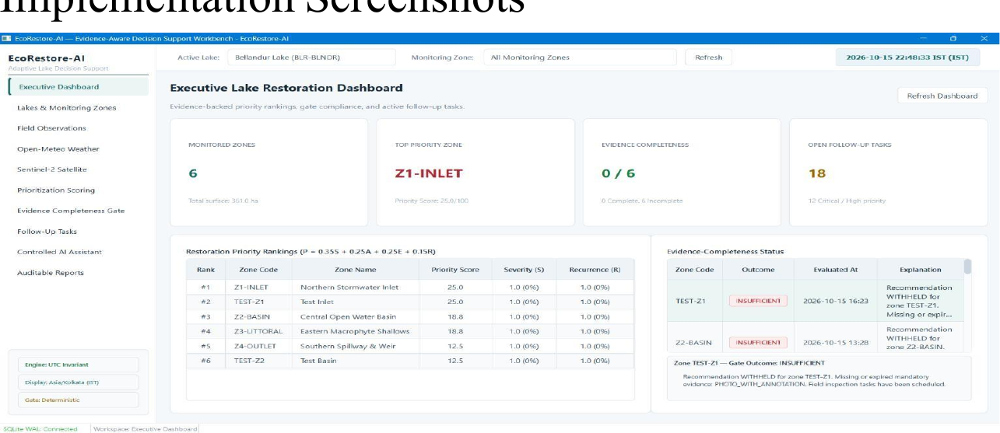

<br>

**EcoRestore-AI Executive Dashboard**

</div>

---

## 🌿 Project Overview

Urban lakes can experience problems such as waste accumulation, algal growth, damaged shoreline vegetation, and other local disturbances.

In many monitoring situations, field observations, photographs, restoration activities, and follow-up records may be stored separately. This can make it difficult to compare observations, identify incomplete evidence, track activities, and understand which monitoring zones require further attention.

**EcoRestore-AI** addresses this workflow problem by providing a structured environment for:

- Collecting field observations
- Organizing environmental evidence
- Validating evidence completeness
- Applying transparent priority scoring
- Monitoring restoration activities
- Tracking follow-up observations
- Generating auditable reports

> **Important:** EcoRestore-AI is a decision-support system. It does not physically restore a lake, replace environmental experts, or automatically prescribe restoration treatments.

---

## ✨ Core Capabilities

<table>
<tr>
<td width="50%" valign="top">

### 🌊 Lake Management

Manage lakes, monitoring zones, boundaries, and environmental records.

</td>
<td width="50%" valign="top">

### 📋 Field Observations

Record measurements, observations, photographs, severity, recurrence, and ecological notes.

</td>
</tr>

<tr>
<td width="50%" valign="top">

### 📊 Priority Scoring

Apply transparent weighted scoring to identify monitoring zones requiring further attention.

</td>
<td width="50%" valign="top">

### 🔎 Evidence Gate

Identify incomplete or insufficient evidence before recommendations are reviewed.

</td>
</tr>

<tr>
<td width="50%" valign="top">

### 🛰️ Environmental Data

Use geographic, satellite, and weather information as supplementary environmental context.

</td>
<td width="50%" valign="top">

### 🤖 Controlled AI

Provide local AI assistance through an Ollama-based controlled tool layer.

</td>
</tr>

<tr>
<td width="50%" valign="top">

### 📈 Follow-Up Monitoring

Connect baseline observations with subsequent monitoring and restoration activities.

</td>
<td width="50%" valign="top">

### 📄 Auditable Reports

Generate reports containing observations, evidence, activities, priority information, and follow-up records.

</td>
</tr>
</table>

---

## 📌 Project at a Glance

| Category | Details |
|---|---|
| **Project Type** | Desktop Decision-Support Application |
| **Domain** | Environmental Monitoring / Urban Lake Restoration |
| **Programming Language** | Python |
| **Desktop Interface** | PySide6 |
| **Database** | SQLite |
| **ORM / Data Access** | SQLAlchemy |
| **Local AI** | Ollama |
| **Satellite Context** | Sentinel-2 |
| **Weather Context** | Open-Meteo |
| **Geographic Context** | OpenStreetMap |
| **Decision Model** | Transparent Weighted Priority Scoring |
| **Evidence Control** | COMPLETE / PARTIAL / INSUFFICIENT |
| **Source Code** | Private |
| **Current Status** | Demonstrated |

---

## 🚀 Key Features

<details>
<summary><b>🌊 Lake and Monitoring-Zone Management</b></summary>

<br>

- Maintain structured lake records
- Divide a selected lake into monitoring zones
- Store zone-specific observations
- Organize monitoring information for later comparison
- Maintain geographic and monitoring-related information

</details>

<details>
<summary><b>📋 Field Observation Management</b></summary>

<br>

Observations can contain:

- Observation date
- Zone ID
- Observation category
- Severity
- Affected-area estimate
- Recurrence
- Notes
- Supporting photographs
- Human-entered annotations

</details>

<details>
<summary><b>🔎 Evidence-Aware Assessment</b></summary>

<br>

The system evaluates whether required evidence is available and sufficiently complete before a recommendation is considered ready for review.

The evidence-completeness workflow helps identify:

- Missing information
- Incomplete records
- Outdated evidence
- Records requiring further review

</details>

<details>
<summary><b>📊 Transparent Priority Scoring</b></summary>

<br>

Monitoring zones are prioritized using four weighted criteria:

| Criterion | Weight |
|---|---:|
| Severity | 35% |
| Affected Area | 25% |
| Ecological Sensitivity | 25% |
| Recurrence | 15% |

The weights are configurable/provisional and require appropriate guide or expert review before being treated as final environmental decision criteria.

The score is designed to make the contribution of individual criteria inspectable rather than hiding the prioritization logic inside an opaque model.

</details>

<details>
<summary><b>🛰️ Environmental Data Integration</b></summary>

<br>

The project incorporates complementary environmental context through:

- OpenStreetMap services
- Sentinel-2 satellite imagery
- Open-Meteo weather data

These sources provide geographic, spectral, and meteorological context for monitoring.

</details>

<details>
<summary><b>🌱 Restoration Activity Tracking</b></summary>

<br>

The system can record:

- Planned activities
- Completed activities
- Activity dates
- Responsible teams
- Monitoring zones
- Notes
- Supporting evidence

</details>

<details>
<summary><b>📈 Follow-Up Monitoring</b></summary>

<br>

Baseline and follow-up observations can be connected to support comparison over time.

The system reports observed changes without claiming that a particular restoration activity caused those changes.

</details>

<details>
<summary><b>🤖 Controlled Local AI Assistance</b></summary>

<br>

EcoRestore-AI includes a controlled local AI assistant design using **Ollama**.

The AI layer is designed around defined tools and deterministic fallback behaviour.

Important decision-support functions such as evidence assessment and priority scoring remain independent of language-model availability.

</details>

<details>
<summary><b>📄 Report Generation</b></summary>

<br>

The system supports the generation of auditable restoration-related reports containing relevant observations, evidence, activities, priority information, and follow-up records.

</details>

---

## 🔄 System Workflow

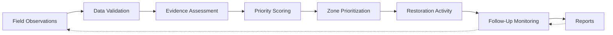

### Workflow Summary

**Observe → Validate → Assess Evidence → Score → Prioritize → Track Activity → Monitor → Report**

---

## 🏗️ System Architecture

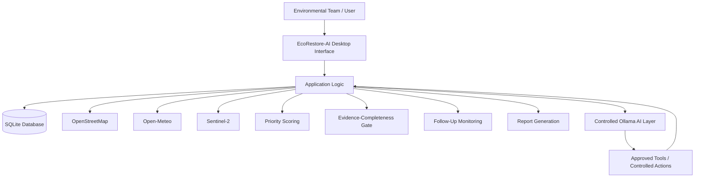

---

## 📊 Priority Scoring Model

The project uses a transparent weighted scoring approach based on four criteria:

```text
Priority Score =
    0.35 × Severity
  + 0.25 × Affected Area
  + 0.25 × Ecological Sensitivity
  + 0.15 × Recurrence
```

The purpose of this score is to provide a transparent screening mechanism for identifying monitoring zones that may require further environmental assessment.

It is **not intended to automatically prescribe a restoration treatment**.

---

## 🔎 Evidence-Completeness Gate

A central concept of EcoRestore-AI is the **Evidence-Completeness Gate**.

Before a recommendation is considered ready for review, the system checks whether the required evidence is available.

```text
              Evidence Assessment
                      │
          ┌───────────┼───────────┐
          ↓           ↓           ↓
      COMPLETE      PARTIAL   INSUFFICIENT
          │           │           │
          ↓           ↓           ↓
     Ready for     Additional   Further Data
       Review       Evidence     Collection
                     Needed       Required
```

### Evidence States

| State | Meaning | Action |
|---|---|---|
| **COMPLETE** | Required evidence is available | Ready for review |
| **PARTIAL** | Some evidence is available | Additional evidence recommended |
| **INSUFFICIENT** | Important evidence is missing or inadequate | Further data collection required |

This helps prevent incomplete observations from being treated as if they were complete environmental evidence.

---

## 🌍 Environmental Data Sources

### OpenStreetMap

Used for geographic discovery and mapped boundary information.

### Sentinel-2

Used as supplementary satellite-based environmental context.

The project documentation includes satellite scene inspection and spectral analysis workflows, including NDWI- and NDVI-based analysis.

### Open-Meteo

Used to provide weather-related environmental context for monitoring records.

> These external sources complement manually collected field observations rather than replacing them.

---

## 🧩 Application Modules

| Module | Purpose |
|---|---|
| Dashboard | Provides an overview of project and monitoring information |
| Lake Registry | Manages lake records |
| Monitoring Zones | Defines and manages monitoring areas |
| Field Observation | Records environmental observations |
| Image Records | Stores supporting observation photographs and metadata |
| Environmental Data | Provides external environmental context |
| Priority Scoring | Calculates transparent weighted scores |
| Evidence Gate | Checks evidence completeness |
| Activity Tracking | Records restoration-related activities |
| Follow-Up Monitoring | Connects baseline and follow-up observations |
| AI Assistant | Provides controlled local AI assistance |
| Report Generation | Produces auditable project reports |
| Testing | Supports unit and integration testing |

---

# 📸 Application Gallery

The following screenshots document the major application workflows.

## 🌊 Lake & Monitoring Management

<details>
<summary><b>View Lake Management Screenshots</b></summary>

<br>

### Executive Dashboard

<p align="center">
  
</p>

### Lake Registry

<p align="center">
  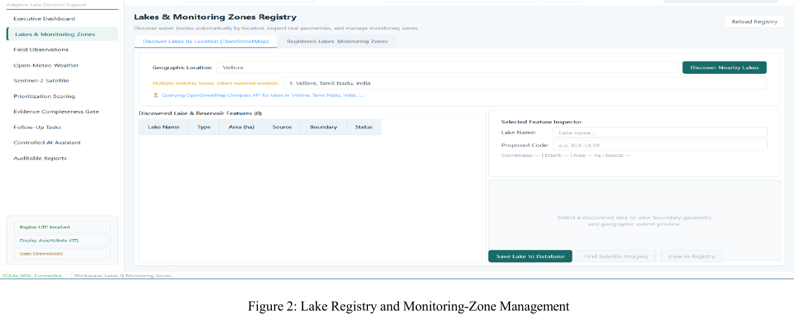
</p>

### Lake Boundary

<p align="center">
  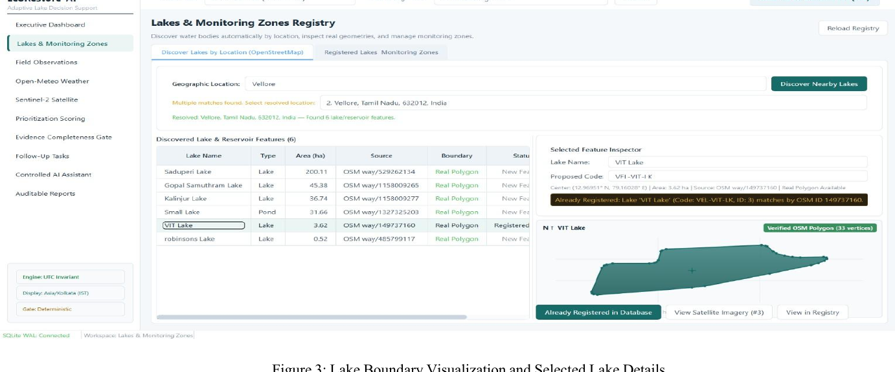
</p>

### Monitoring Zones

<p align="center">
  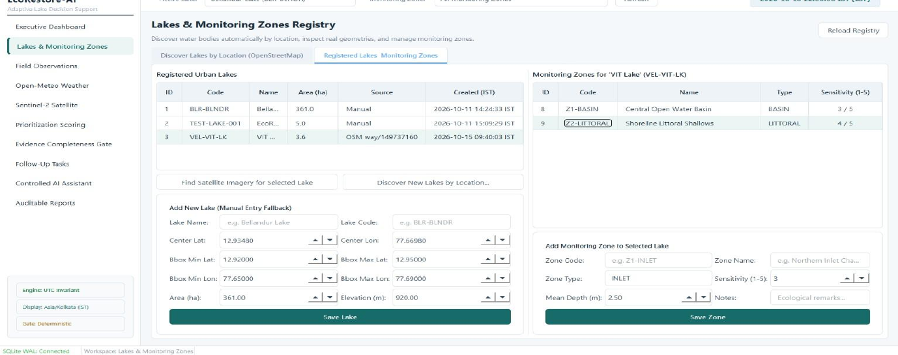
</p>

### Field Observations

<p align="center">
  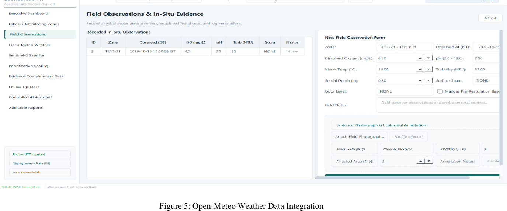
</p>

</details>

---

## 🛰️ Environmental Data & Analysis

<details>
<summary><b>View Environmental Analysis Screenshots</b></summary>

<br>

### Open-Meteo Weather Context

<p align="center">
  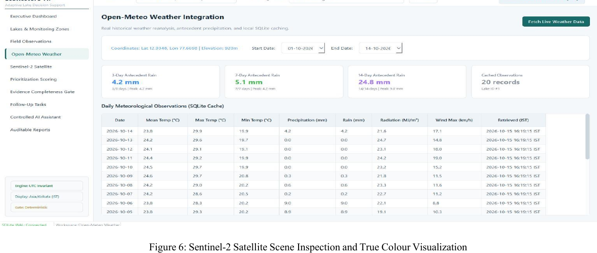
</p>

### Sentinel-2

<p align="center">
  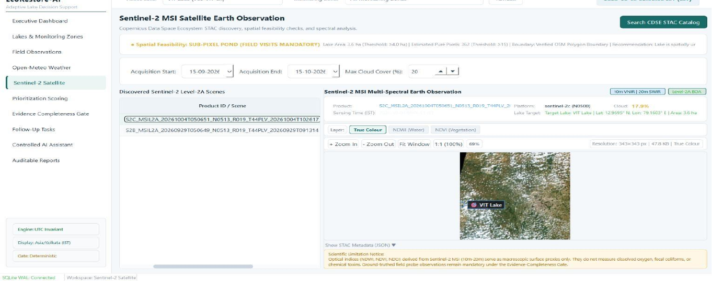
</p>

### NDWI Analysis

<p align="center">
  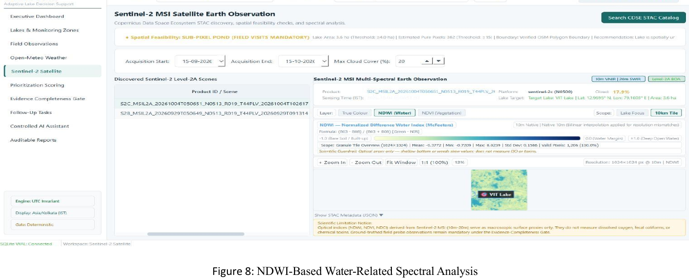
</p>

### NDVI Analysis

<p align="center">
  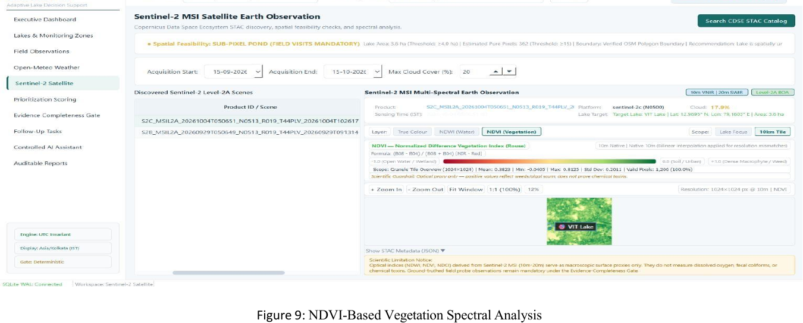
</p>

</details>

---

## 📊 Decision Support

<details>
<summary><b>View Priority & Evidence Screenshots</b></summary>

<br>

### Priority Scoring

<p align="center">
  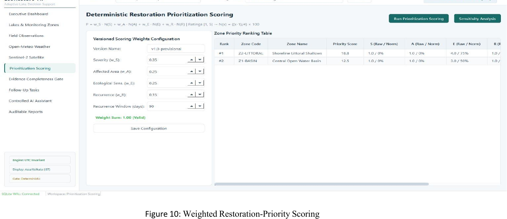
</p>

### Evidence Completeness

<p align="center">
  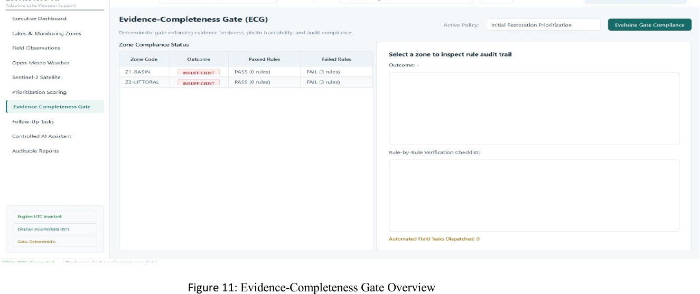
</p>

### Evidence Gate Outcome

<p align="center">
  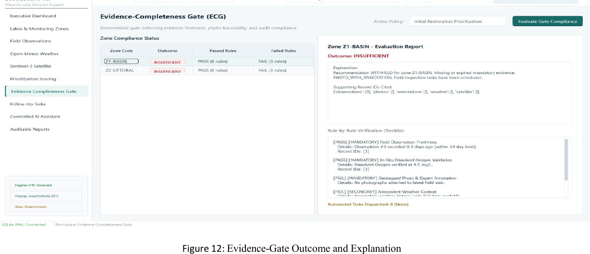
</p>

### Follow-Up Tasks

<p align="center">
  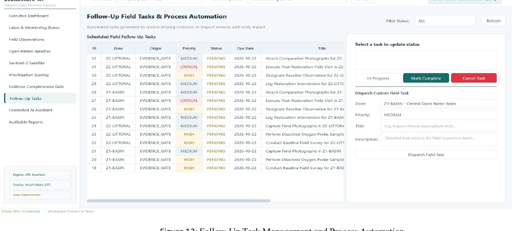
</p>

</details>

---

## 🤖 AI, Reports & Testing

<details>
<summary><b>View AI, Reporting and Testing Screenshots</b></summary>

<br>

### AI Assistant

<p align="center">
  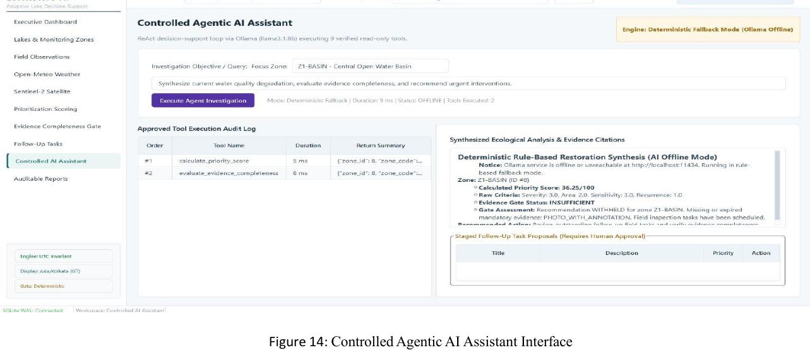
</p>

### Report Generation

<p align="center">
  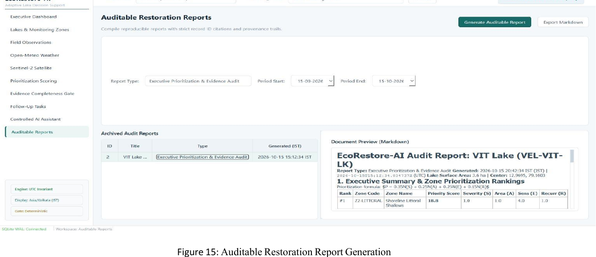
</p>

### Unit Testing

<p align="center">
  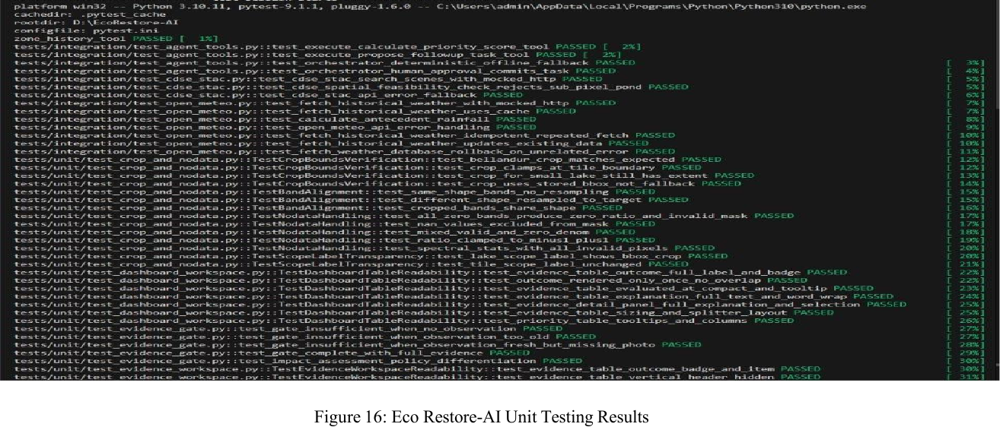
</p>

### Integration Testing

<p align="center">
  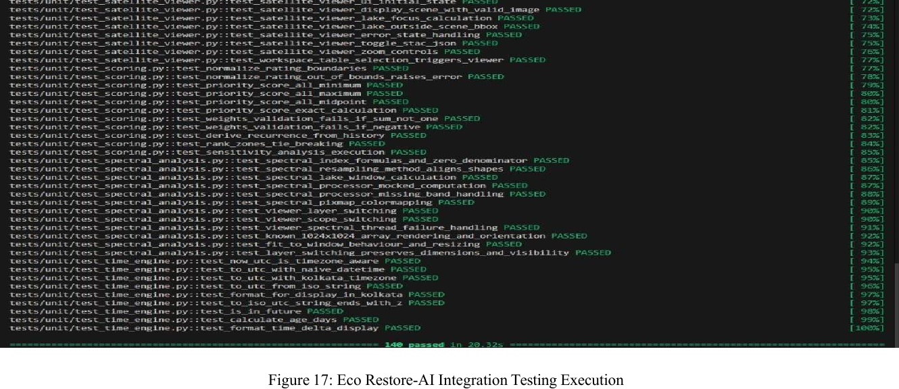
</p>

</details>

---

## 🎬 Demonstration

### Video Demo

Application demonstration media is available through the project demonstration link.

> The public repository currently contains documentation and screenshots. The complete source code remains private.

### Animated Workflow

A GIF can be added later to demonstrate the complete application flow:

```text
Field Observation
       ↓
Evidence Check
       ↓
Priority Scoring
       ↓
Activity Tracking
       ↓
Follow-Up Monitoring
       ↓
Report Generation
```

**Suggested future asset:**

```text
assets/ecorestore-workflow.gif
```

Once the GIF is available, it can be embedded directly here:

```html
<p align="center">
  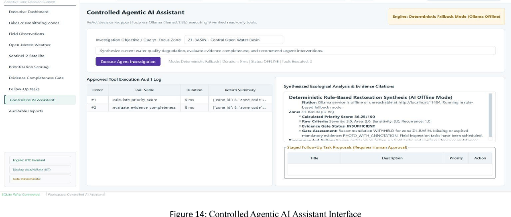
</p>
```

---

## 🧪 Testing & Validation

The project documentation describes evaluation through:

- Automated unit testing
- Integration testing
- Workflow checks
- Manual verification of application behaviour

These tests are intended to verify individual components as well as the overall application workflow.

<details>
<summary><b>View Testing Evidence</b></summary>

<br>

<p align="center">
  
</p>

<p align="center">
  
</p>

</details>

---

## 💻 Technology Stack

| Layer | Technology |
|---|---|
| **Programming Language** | Python |
| **Desktop UI** | PySide6 |
| **Database** | SQLite |
| **ORM / Data Access** | SQLAlchemy |
| **Local AI** | Ollama |
| **Geographic Data** | OpenStreetMap |
| **Satellite Data** | Sentinel-2 |
| **Weather Data** | Open-Meteo |
| **Data Processing** | Python-based processing |
| **Testing** | Unit Testing + Integration Testing |

---

## 💡 Novelty & Key Contribution

EcoRestore-AI combines several environmental monitoring and decision-support functions into one evidence-aware workflow.

### 1. Evidence-Aware Restoration Decision Support

The system organizes field observations, environmental context, evidence completeness, and priority assessment into a connected workflow.

### 2. Transparent and Configurable Priority Scoring

Instead of relying on an unexplained prediction, the system exposes the criteria and weights contributing to a monitoring-zone priority score.

### 3. Integrated Environmental Evidence

Geographic information, satellite imagery, weather context, and manually collected observations can be considered together.

### 4. Traceable Monitoring and Follow-Up

Observations, evidence, priority scores, restoration activities, and follow-up tasks can be connected for later review.

### 5. Controlled Local AI Assistance

The project incorporates a local Ollama-based assistant while keeping essential deterministic decision-support functions independent of the language model.

---

## 🎯 Important Project Positioning

EcoRestore-AI is a **decision-support system**, not an autonomous environmental decision maker.

### The system does:

- Organize environmental evidence
- Identify incomplete evidence
- Provide transparent priority scoring
- Support monitoring workflows
- Track restoration activities
- Generate reports

### The system does not:

- Physically restore lakes
- Replace environmental experts
- Automatically prescribe restoration treatments
- Claim causal relationships from observed changes
- Claim predictive-model accuracy from a custom trained ML model

---

## 📌 Current Implementation Status

The project includes documented application workflows covering:

- Executive dashboard
- Lake registry
- Monitoring-zone management
- Field observation entry
- Weather integration
- Satellite scene inspection
- NDWI analysis
- NDVI analysis
- Weighted restoration-priority scoring
- Evidence-completeness assessment
- Follow-up task management
- Controlled AI assistant
- Restoration report generation
- Unit testing
- Integration testing

Further refinement and validation can be performed as the project progresses.

---

## 📍 Project Status

| Component | Status |
|---|---|
| Desktop Application | Demonstrated |
| Lake & Zone Management | Implemented |
| Field Observation Workflow | Implemented |
| Priority Scoring | Implemented |
| Evidence Gate | Implemented |
| Environmental Data Integration | Demonstrated |
| AI Assistant | Demonstrated |
| Report Generation | Demonstrated |
| Testing | Documented |
| **Public Source Code** | **Private** |

---

## ⚠️ Limitations

1. Priority-score weights are provisional and require expert review.
2. Environmental decisions still require domain-expert assessment.
3. Observed changes should not automatically be interpreted as causal effects of restoration activities.
4. Satellite and weather information provides supplementary context rather than replacing field observations.
5. The project does not currently report accuracy from a custom trained predictive ML model.

---

## 🔮 Future Enhancements

Potential future improvements include:

- Expanded multi-lake monitoring
- More comprehensive environmental indicators
- Additional satellite-based analysis
- Improved longitudinal monitoring
- Advanced visualization dashboards
- More environmental data sources
- Expert-reviewed scoring weights
- Additional AI-assisted workflows
- Improved report customization
- Deployment-oriented architecture

---

## 👥 Project Team

| Member | Registration Number |
|---|---|
| Lakshmi B | 23MID0401 |
| Divya P | 23MIC0125 |
| Prithiga V | 23MIC0108 |

**Guide:** Biji C L

---

## 🎓 Academic Context

| Category | Details |
|---|---|
| **Project** | EcoRestore-AI |
| **Domain** | Environmental Monitoring / Decision Support / AI-Assisted Data Management |
| **Application Type** | Desktop Decision-Support Application |
| **Project Nature** | Academic Project |

---

## 🔐 Source Code Availability

> **Source Code: Private**

This GitHub repository is intended as a **project documentation and demonstration repository**.

The complete application source code is **not publicly included** in this repository because the implementation is currently maintained privately for academic project development.

The repository currently provides:

- Project documentation
- System architecture
- Workflow diagrams
- Application screenshots
- Demonstration information
- Testing documentation
- Project status
- Supporting visual materials

The source code may be added later after the project is finalized and the team confirms its release.

---

## 📚 References

The project literature review includes research covering:

- Lake eutrophication and restoration
- Water-quality monitoring
- Restoration effectiveness
- Multi-criteria decision analysis
- Satellite-based lake monitoring
- Environmental sensor systems
- Long-term water-quality analysis
- Urban lake monitoring

Detailed references and DOI information are available in the project report.

---

## 📝 Conclusion

EcoRestore-AI provides a structured and transparent approach to supporting urban lake restoration planning.

By combining field observations, environmental evidence, transparent priority scoring, evidence-completeness assessment, activity tracking, follow-up monitoring, and controlled local AI assistance, the system helps organize information required for environmental review.

The central goal is not to replace environmental expertise, but to provide a traceable and evidence-aware workflow that can help environmental teams organize observations and identify areas requiring further assessment.

---

<div align="center">

## 🌿 EcoRestore-AI

### Evidence → Assessment → Prioritization → Monitoring → Reporting

**Academic Project • Environmental Decision Support • Source Code Private**

</div>

<div align="center">


</div>
